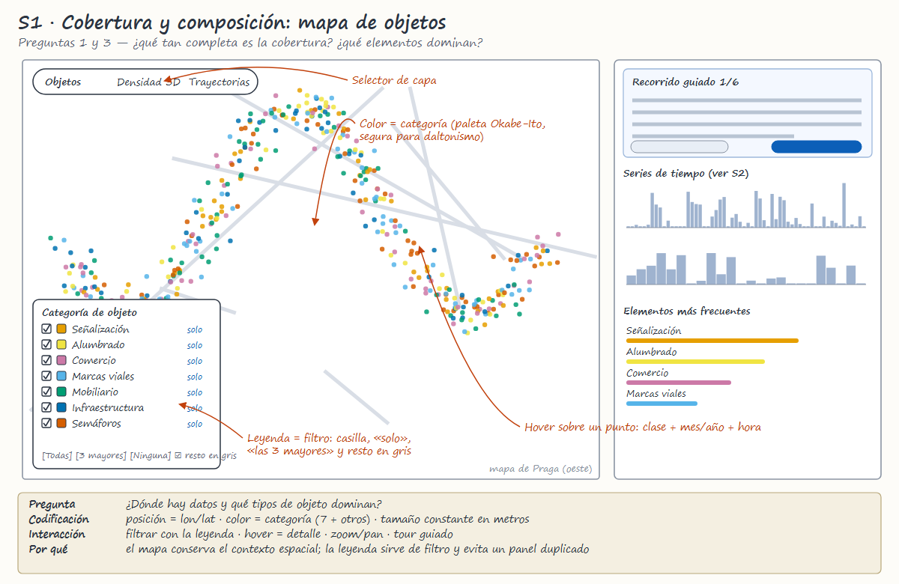
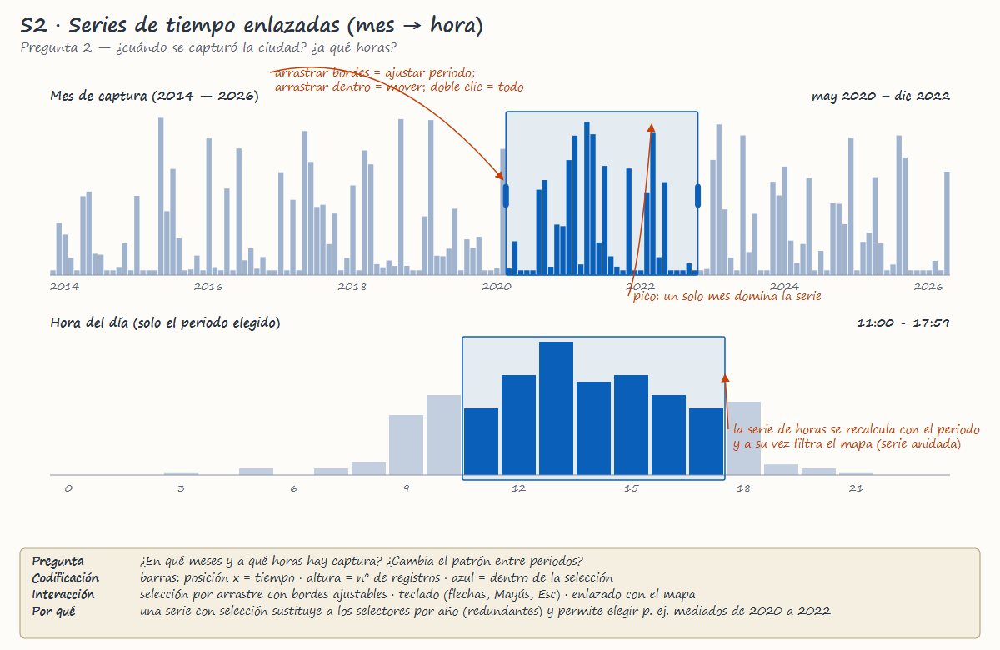
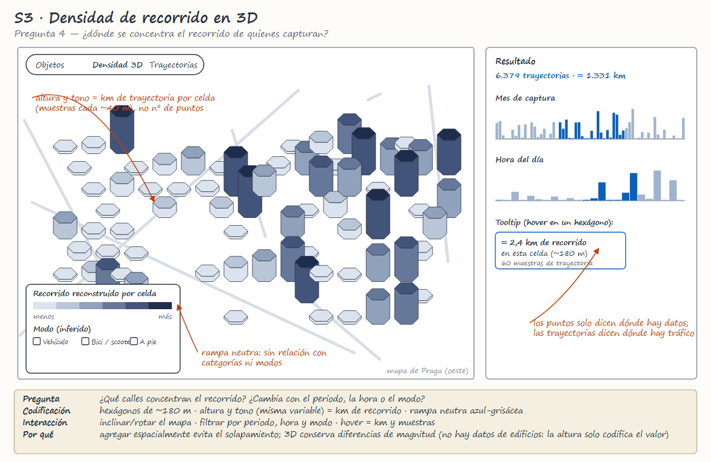
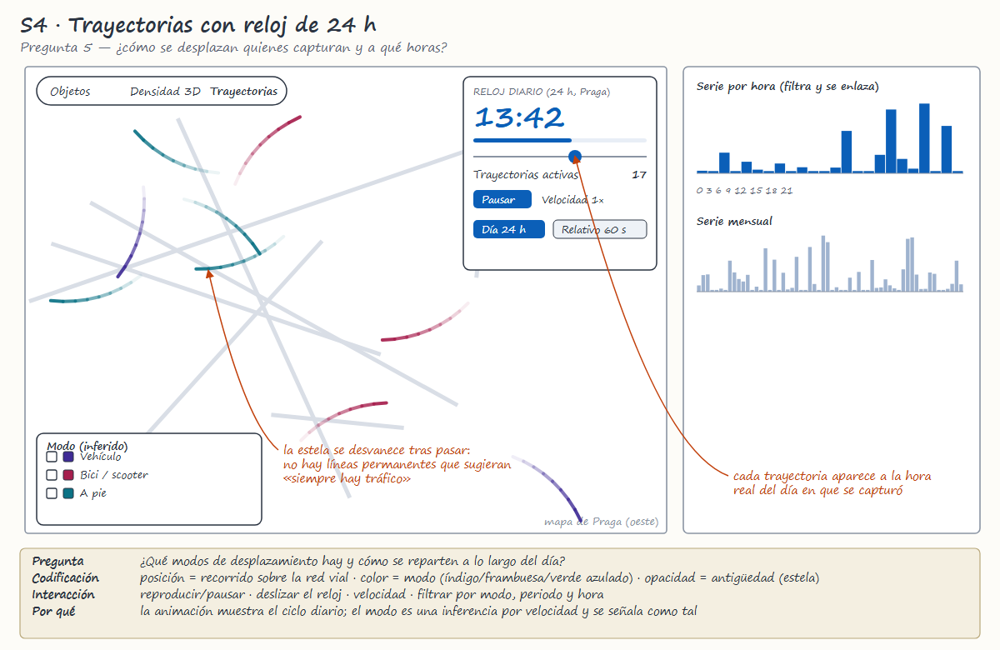
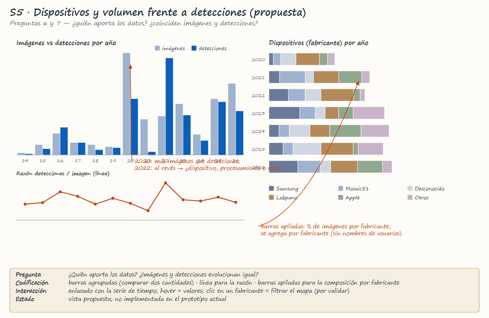
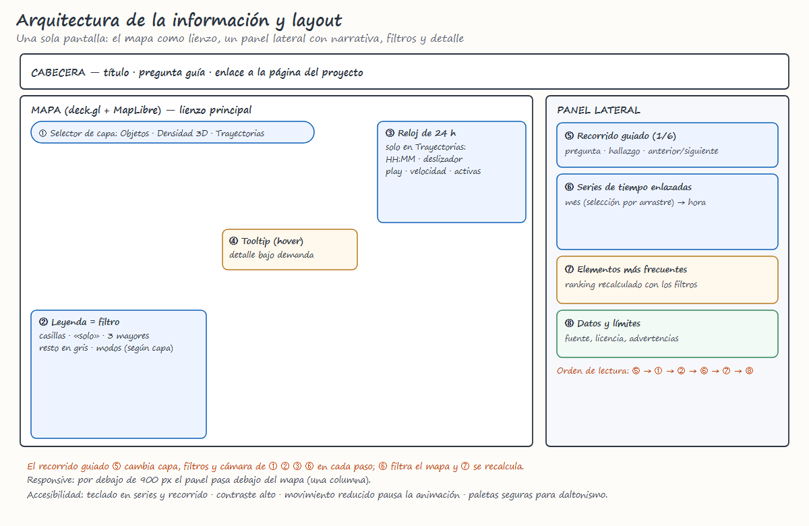
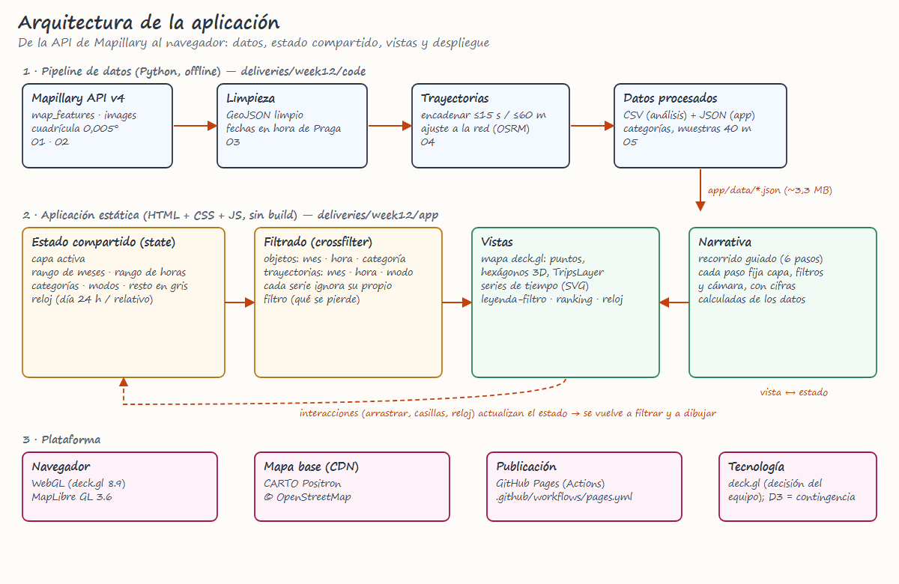

# Delivery 1 — Informe consolidado de la primera fase

Praga a pie de calle · DS5343 Data Visualization · 2026-2 · entrega del 23 de septiembre de 2026

> **Nota de consolidación.** Documento completado el 2 de noviembre de 2026 con el estado y las cifras del proyecto a esa fecha; no refleja necesariamente el contenido presentado en la fecha original del hito.

## 1. Problema, audiencia y dataset (revisados)

**Problema.** Los datos colaborativos de fotografía a nivel de calle (Mapillary) se usan como si describieran la ciudad, pero cada dato existe porque alguien capturó ese lugar en ese momento y con un dispositivo concreto. Queremos hacer visible ese sesgo en una zona del oeste de Praga (~4,6 × 8,9 km).

**Audiencia.** Analistas y estudiantes de datos geoespaciales y de movilidad urbana que evalúan datos colaborativos. **Propósito:** explorar y evaluar —no decidir— si los datos sirven para su análisis.

**Dataset.** Mapillary API v4 (`map_features` e `images`, CC BY-SA): 39.564 detecciones de objetos (277 clases, 1.096 secuencias, 2014–2026), 76.225 imágenes con metadatos de cámara en la zona y 6.379 trayectorias reconstruidas. Detalle en [`../week04/`](../week04/) y [`../week06/DataAnalysis.md`](../week06/DataAnalysis.md).

## 2. Secuencia de preguntas de dominio (revisada)

| # | Pregunta | Cambio respecto a la propuesta |
|---|---|---|
| 1 | ¿Qué tan completa es la cobertura? ¿Dónde hay datos y dónde no? | — |
| 2 | ¿Cómo se distribuye la captura por mes y hora del día? | de «por año» a **mes y hora enlazados** |
| 3 | ¿Qué tipos de objetos urbanos dominan? | — |
| 4 | ¿Dónde se concentra el **recorrido** de quienes capturan? | de «dónde hay más objetos» a recorrido, porque los puntos no miden tráfico |
| 5 | ¿Cómo se reparten por hora los desplazamientos inferidos? | se declara que el modo es una inferencia |
| 6 | ¿Qué dispositivos aportan los datos? | — |
| 7 | ¿Coinciden el volumen de imágenes y el de detecciones? | — |

## 3. Análisis de datos y bocetos candidatos

Resumen del análisis (cifras completas en `week06/DataAnalysis.md`):

- **Cobertura concentrada:** el 39,5 % de las detecciones cae en el 10 % de las celdas de ~100 m.
- **Captura muy desigual:** octubre de 2022 aporta el 26,0 % de todas las detecciones y los cinco meses mayores suman el 52,3 %.
- **Composición:** señalización 34,4 %, alumbrado 25,0 %, comercio 11,8 %.
- **Dispositivos:** Samsung 27 %, Mosaic51 20 %, desconocido 13 %.
- **Discrepancia sin explicar:** 2020 tiene más imágenes (15.259) y 2022 más detecciones (10.446).

Bocetos candidatos finales (en [`sketches/`](sketches/)):

| Boceto | Pregunta | Descripción |
|---|---|---|
|  | P1, P3 | **S1.** Mapa de objetos con leyenda que filtra |
|  | P2 | **S2.** Series de tiempo enlazadas (mes → hora) |
|  | P4 | **S3.** Densidad de recorrido en 3D |
|  | P5 | **S4.** Trayectorias con reloj de 24 h |
|  | P6, P7 | **S5.** Dispositivos y volumen frente a detecciones (propuesta) |

## 4. Dirección de visualización seleccionada y justificación

**Una sola aplicación guiada, con el mapa como lienzo y filtros enlazados**, compuesta por S1–S4 (S5 queda como ampliación).

- *Por qué un mapa:* la pregunta central es espacial; el contexto geográfico es insustituible.
- *Por qué tres capas:* puntos (qué y dónde), hexágonos 3D (concentración del recorrido) y trayectorias animadas (cuándo y cómo se mueven); una sola capa visible a la vez evita el desorden.
- *Por qué series enlazadas:* un filtro por mes y por hora, con selección por arrastre, es más informativo que selectores por año y permite estudiar el ciclo diario de un periodo.
- *Por qué una narrativa guiada:* los lineamientos piden un recorrido que no sea «una colección de gráficos desconectados».

Alternativas descartadas: mapa de calor 2D (oculta diferencias de magnitud), un gráfico de barras por año como único filtro temporal (pierde la hora y el mes).

## 5. Arquitectura de la información y layout

Una pantalla con el mapa a la izquierda y un panel lateral a la derecha (en móvil, el panel pasa debajo).

Los diagramas están en [`architecture/`](architecture/) (PNG y SVG editable).

## 6. Plan de implementación priorizado

| Prioridad | Tarea | Resultado | Estado a la fecha |
|---|---|---|---|
| 1 | Pipeline de datos reproducible (01–05) y datos compactos JSON | `app/data/*.json`, CSV | Hecho |
| 2 | Mapa con capa de objetos y leyenda-filtro | S1 | Hecho |
| 3 | Series de tiempo enlazadas (mes → hora) | S2 | Hecho |
| 4 | Trayectorias con estelas y reloj de 24 h | S4 | Hecho |
| 5 | Densidad de recorrido 3D | S3 | Hecho |
| 6 | Recorrido guiado y textos con cifras calculadas | narrativa | Hecho |
| 7 | Dispositivos y volumen frente a detecciones | S5 | Pendiente |
| 8 | Descargar lotes 3–5 de `map_features` | cobertura completa | Pendiente (requiere token) |
| 9 | Pruebas de usabilidad informales y ajustes | feedback | Pendiente |
| 10 | Paper, videos, póster y página del proyecto | entrega final | En curso |

**Tecnología.** Mapa y capas con **deck.gl** (HTML, CSS y JavaScript sin *build*). Los lineamientos (§3.3) establecen D3.js como tecnología principal: el equipo decidió mantener deck.gl y **debe confirmar esa excepción con la profesora**. Plan de contingencia: las series de tiempo y la leyenda son SVG/JS propios y pueden portarse a D3 (`d3-scale`, `d3-brush`) sin tocar el mapa.

## 7. Responsabilidades y calendario hasta la Semana 15

**Responsabilidades**

| Integrante | Responsabilidades |
|---|---|
| Jeffry Arturo Hilario Quintana | Extracción y limpieza de datos, desarrollo de la visualización, documentación |
| *[Completar]* | *[Completar]* |
| *[Completar]* | *[Completar]* |

**Calendario**

| Semana | Fecha | Hito | Entregable | Responsable |
|---|---|---|---|---|
| 7 | 23 sep | Delivery 1 | Este informe | *[Completar]* |
| 8 | — | Sin entrega (examen parcial) | Consolidar feedback | — |
| 10 | 14 oct | Prototipo funcional | `deliveries/week10/` | *[Completar]* |
| 12 | 28 oct | Borrador refinado y crítica de pares | `deliveries/week12/` | *[Completar]* |
| 13–14 | 4 y 11 nov | Pulido, paper, videos y póster | borradores | *[Completar]* |
| 15 | 18 nov | Entrega final y exposición | paquete completo + póster | Todo el equipo |

## 8. Reflexión: qué cambió después de examinar los datos

1. **La zona real es menor a la planeada.** Solo se descargaron 2 de los 5 lotes de detecciones; la zona de estudio pasó de ~10,7 × 8,9 km a ~4,6 × 8,9 km.
2. **Los puntos no miden tráfico.** La pregunta 4 pasó de «¿dónde hay más objetos?» a «¿dónde se concentra el recorrido?», y se pidió medirlo con trayectorias.
3. **La captura está muy concentrada en el tiempo** (un solo mes aporta una cuarta parte de los datos), lo que convirtió el sesgo de captura en el mensaje central del proyecto.
4. **Las trayectorias son una inferencia débil.** Los tramos duran unos 2 s y las velocidades son poco fiables (el 25 % supera los 80 km/h); por eso el modo de transporte se presenta como inferido y no como un hecho.
5. **El filtro por año no bastaba.** Se sustituyó por series enlazadas por mes y hora.
6. **La discrepancia entre imágenes y detecciones** (2020 frente a 2022) abrió una pregunta nueva (P7) que aún no sabemos explicar.
